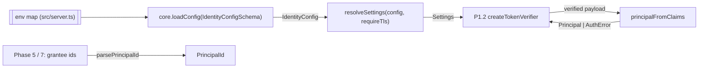

# P1.1 Principal: identity values, config, claim rules

**Status: BINDING.** Gates answered (D3, D4, D5; decision log Q28–Q30).
Approved by a human on 2026-10-03. Implement this file, not the brief cell in
[`phase-1.md`](phase-1.md).
**Public API:** v0.1 of `src/identity/index.ts` (first slice).
**Depends on:** Phase 0 (`src/core/index.ts` v1.0).
**Next:** [`PHASE1_P1.2_VERIFIER.md`](PHASE1_P1.2_VERIFIER.md).

## Context and scope

The brief [`phase-1.md`](phase-1.md) names one design, `PHASE1_IDENTITY.md`.
It is split into two slices, as Phase 0 was:

- P1.1 (this file) defines the values the rest of the service sees (who the
  caller is, why a token failed), the config schema, and the pure rules that
  turn a verified claim set into a `Principal`. No `jose`, no network.
- P1.2 installs `jose`, builds `TokenVerifier`, owns the remote key set and its
  readiness probe, and closes Phase 1.

The two slices together are the brief's `PHASE1_IDENTITY.md`.

Facts:

- Phase 0 is landed (status table in [`README.md`](README.md)). It gives
  `Result`, `AppError`, `ErrorCode`, and `loadConfig` (`src/core/index.ts`).
- `loadConfig` takes a TypeBox `TObject` and reports names from `required`
  errors and the first segment of `instancePath`
  ([P0.1 D2](PHASE0_P0.1_FOUNDATION.md)). A rule across two properties
  (`oneOf`, `not`) fails at path `""`, so `loadConfig` would name nothing.
  That is why D5 exists.
- `REQUIRE_TLS` keeps its meaning in Phase 0: anything but `'false'` means TLS
  ([P0.2 D2](PHASE0_P0.2_SERVER.md)). Phase 1 must not reinterpret the raw
  string.
- The product contract fixes the principal id `user:<PRINCIPAL_NAMESPACE>~<sub>`,
  the `sub` character ban, the namespace's lack of a default, and the two
  service modes ([`docs/product.md`](../../docs/product.md) "Principals").
  ADR-005 adapts Lakekeeper's `<idp>~<sub>` id and provider-record shape
  (`inspo/indexing/lakekeeper-oidc-provider-agnostic-authn.md`,
  `inspo/indexing/cosmos-idp-agnostic-verdict.md`). ADR-017 bans vendor names
  in identifiers and defaults.
- Lakekeeper restricts its namespace key to `[a-z0-9-]+`
  (`lakekeeper-oidc-provider-agnostic-authn.md`, "The provider id is the
  identity namespace", `authn.rs:598-603`).
- `jose` 6.2.12 (measured 2026-10-03, see P1.2 Context) accepts a token whose
  `sub` is a number. Narrowing `sub` is therefore this phase's job, not the
  library's.
- The brief cites `R…`/`RR…` mapping files (`docs/review-phase-0-mapping.md`,
  `docs/review-readme-mapping.md`) that are not in this checkout. The ids it
  lists (R5.1–R5.4, R8.6, R14; RR2, RR3, RR4, RR11) are carried as plain text
  and are not linked.

P1.1 owns these exports: `PrincipalId`, `PrincipalKind`, `Principal`,
`AuthFailure`, `AuthError`, `IdentityConfigSchema`, `IdentityConfig`,
`parsePrincipalId`. It also lands two private pure functions that P1.2 calls:
`resolveSettings` (D5) and `principalFromClaims` (D6).

## Goals and non-goals

**Goals**

- G1 — A `PrincipalId` exists only through `parsePrincipalId` or
  `principalFromClaims`, and both call `brandPrincipalId`. A plain string does
  not typecheck as one (standards §3, exception in D2).
- G2 — Every authentication failure is one `AuthError`: code
  `unauthenticated`, one reason from a closed set, one fixed message, no
  `cause`.
- G3 — Claim mode: a claim set with the configured `claim=value` is `service`;
  one without it is `human`, whatever its `sub` looks like. Suffix mode:
  classification follows the suffix only. (brief done-when 2, 3)
- G4 — Both service modes set, or neither, is `invalid_argument` naming both
  variables. `IDP_JWKS_URI` not HTTPS while TLS is required is
  `invalid_argument` naming it. (brief done-when 4, reworded by D5)
- G5 — No vendor string in `src/identity/`. (brief done-when 5)

**Non-goals**

- Verifying signatures, fetching keys, and parsing the `Authorization` header.
  These are P1.2.
- Several IdPs at once, issuer routing, and Lakekeeper's required-claim rules
  (`any_of`, `all_of`). The product names one IdP and one audience. The
  verdict note's provider list can arrive later as a minor API change.
- A configurable subject claim (Lakekeeper's `oid` then `sub`). The product
  contract fixes `sub`.
- Dotted claim paths in `SERVICE_SUBJECT_CLAIM`. The claim is top-level.
- Roles, groups, email, or display names from the token. Roles live in
  OpenFGA (Phase 3).
- A length cap or a character allowlist on `sub` beyond the product's ban.
  OpenFGA's own id limits are Phase 2's concern.
- Checking that a principal has ever logged in (decision Q8).

## The actual design

### Overview

Three pure pieces, in the order the tickets build them:

1. **Values (D1, D2, D3).** The `PrincipalId` brand and its parser, the
   `Principal` record, and the closed `AuthFailure` set with its fixed message.
2. **Config (D4, D5).** `IdentityConfigSchema` for `loadConfig`, then
   `resolveSettings(config, requireTls)`, which applies the rules that span
   two variables and returns the settings the verifier runs on.
3. **Claim rules (D6).** `principalFromClaims(settings, claims)` turns a
   verified claim set into a `Principal`, or an `AuthError` with reason
   `malformed` or `bad_subject`.

P1.2 is the imperative shell around these: it verifies the token with `jose`
and hands the payload to `principalFromClaims`. Every rule about the subject
and the service mode is testable without keys or a network.

### System context



### APIs

These signatures are normative. Each export carries TSDoc with its contract,
error codes, and side effects (none, in this slice).

```ts
// principal.ts
declare const principalIdBrand: unique symbol;
export type PrincipalId = string & { readonly [principalIdBrand]: true };

export const PrincipalKind: { readonly Human: 'human'; readonly Service: 'service' };
export type PrincipalKind = (typeof PrincipalKind)[keyof typeof PrincipalKind];

export interface Principal {
  readonly id: PrincipalId;
  readonly kind: PrincipalKind;
}

export function parsePrincipalId(
  input: string,
  namespace: string,
): Result<PrincipalId, AppError<'invalid_argument'>>;

// auth-error.ts
export const AuthFailure: {
  readonly Missing: 'missing';
  readonly Malformed: 'malformed';
  readonly BadSignature: 'bad_signature';
  readonly UnknownKey: 'unknown_key';
  readonly AlgorithmNotAllowed: 'algorithm_not_allowed';
  readonly Expired: 'expired';
  readonly NotYetValid: 'not_yet_valid';                 // D3, added to the brief's list
  readonly WrongIssuer: 'wrong_issuer';
  readonly WrongAudience: 'wrong_audience';
  readonly BadSubject: 'bad_subject';
};
export type AuthFailure = (typeof AuthFailure)[keyof typeof AuthFailure];

export interface AuthError {                              // does not extend AppError (D3)
  readonly code: 'unauthenticated';
  readonly message: string;
  readonly reason: AuthFailure;                           // server-side; never decides access
}

// config.ts
export const IdentityConfigSchema: TObject<{ /* table in D4 */ }>;
export type IdentityConfig = Static<typeof IdentityConfigSchema>;
```

Private, not in `index.ts`, called by P1.2:

```ts
function authError(reason: AuthFailure): AuthError;      // auth-error.ts

type ServiceMode =
  | { readonly kind: 'claim'; readonly claim: string; readonly value: string }
  | { readonly kind: 'suffix'; readonly suffix: string };
interface Settings {
  readonly issuer: string;
  readonly audience: string;
  readonly jwksUri: URL;
  readonly algorithms: readonly string[];
  readonly namespace: string;
  readonly serviceMode: ServiceMode;
  readonly jwksTimeoutMs: number;
  readonly clockToleranceS: number;
}
function resolveSettings(config: IdentityConfig, requireTls: boolean):
  Result<Settings, AppError<'invalid_argument'>>;        // settings.ts

function principalFromClaims(settings: Pick<Settings, 'namespace' | 'serviceMode'>,
  claims: Readonly<Record<string, unknown>>): Result<Principal, AuthError>;  // claims.ts
```

`AuthError` has no `authError` export, because no other phase builds one. P1.2
lives in the same folder and imports the private module.

#### D1 — Pure core in P1.1, `jose` only in P1.2's `verifier.ts`

Every rule that decides who the caller is (subject ban, namespace, service
mode, cross-field config) is a pure function in this slice. `jose` is
imported by exactly one file, `src/identity/verifier.ts` (P1.2).

- Gain: done-when 2–5 are unit tests over plain objects. A `jose` upgrade
  cannot change who counts as a service. The test oracle for those rules does
  not depend on signing tokens.
- Cost: `Settings` and `principalFromClaims` are private types that only one
  file consumes, which is a seam with one caller. It is kept because it is the
  boundary between "the library said the token is genuine" and "this service
  decides who it is" (standards §4, JWT row).

#### D2 — `PrincipalId` is a brand, and `parsePrincipalId` checks the configured namespace

Format: `user:` + namespace + `~` + subject, where:

- the namespace matches `^[a-z0-9-]+$` (D4) and **equals** the `namespace`
  argument;
- the subject is everything after the first `~`. It is non-empty and contains
  no `:`, `#`, or whitespace (`/\s/u`). It may contain `~`, since the
  namespace cannot.

Any other input is `invalid_argument` with the fixed message
`invalid principal id`. The input is not echoed: grantee ids arrive from
callers, and the message reaches them.

The one cast to `PrincipalId` lives in `brandPrincipalId`, exported from
`principal.ts` and not from `index.ts`, with the `eslint-disable` line
standards §3 requires. `parsePrincipalId` and `principalFromClaims` are the
two callers. That is the exception to §3's one-parse-function sentence: the
cast still has one home, and no other file casts.

Why the namespace must match: an id in another namespace is well-formed text
but can never be the subject of a verified token in this deployment. A grant to
it is a typo that grants nothing. Rejecting it fails closed at the boundary
(standards §4). Cost: `parsePrincipalId` takes the namespace as an argument,
which `src/server.ts` supplies from `IdentityConfig`. A caller cannot use it
without config.

#### D3 — One fixed message, a closed reason set, never a `cause`

Picked by the user on 2026-10-03 (decision log Q30, with the claim rules in
D6).

- **Message.** Every `AuthError` carries the message
  `invalid or missing credentials`. The reason does not change it, so a caller
  learns nothing from the message about which check failed.
- **Reasons.** The brief's nine plus `not_yet_valid`, for a token whose `nbf`
  is in the future. Reporting it as `expired` would mislabel it, and the reason
  list exists to say what happened. Adding a member later is a major change
  (`policy/phase-composition.md` §6).
- **No `cause`.** `authError` takes only a reason. The `AuthError` interface
  lists `code`, `message`, and `reason`. It does not extend `AppError`, so
  `cause` is not a property and an object literal that sets one does not
  typecheck. A value is still an `AppError<'unauthenticated'>`, because
  `cause` is optional there. `jose` claim errors carry the whole payload
  (`JWTClaimValidationFailed.payload`), so a `cause` would put a claim set
  into whatever logs the error. The product forbids logging claim sets.
- **Reason is not a decision.** No code outside Phase 1 branches on `reason`
  to allow anything. Phase 7 maps the code to `UNAUTHENTICATED`. Whether the
  reason reaches a client is Phase 7's choice. It contains no token data.

#### D4 — Config schema: no defaults, asymmetric algorithms only, two timing variables

Picked by the user on 2026-10-03 (decision log Q28): the JWKS fetch timeout and
the clock tolerance are config. `IDP_JWKS_TIMEOUT_MS` and
`IDP_CLOCK_TOLERANCE_S` are new rows in the root README table, added by
ticket 2.

| Variable | Schema | Notes |
|---|---|---|
| `IDP_ISSUER` | string, `minLength: 1`, required | Exact compare in P1.2. No slash rewrite |
| `IDP_AUDIENCE` | string, `minLength: 1`, required | |
| `IDP_JWKS_URI` | string, `pattern: ^https?://`, required | Parsed with `new URL` in D5. HTTPS rule in D5 |
| `IDP_ALGORITHMS` | string, `pattern` over the list below, comma-separated, no spaces, required | |
| `PRINCIPAL_NAMESPACE` | string, `pattern: ^[a-z0-9-]+$`, required, no default | Cannot contain `~`, `:`, `#`, or whitespace by construction |
| `SERVICE_SUBJECT_CLAIM` | optional string, `pattern: ^[^=]+=.+$` | Split at the first `=`. Value compared as a string |
| `SERVICE_SUBJECT_SUFFIX` | optional string, `minLength: 1` | `:`, `#`, and whitespace are rejected in D5 |
| `IDP_JWKS_TIMEOUT_MS` | integer, minimum 1, required | Key fetch and readiness probe budget (P1.2) |
| `IDP_CLOCK_TOLERANCE_S` | integer, 0–300, required | Skew allowed on `exp` and `nbf` (P1.2). The ceiling stops a typo from extending every token's life by hours |

`IDP_ALGORITHMS` admits only `RS256`, `RS384`, `RS512`, `PS256`, `PS384`,
`PS512`, `ES256`, `ES384`, `ES512`, `EdDSA`. `none` and `HS*` fail the
pattern, so the error is `IDP_ALGORITHMS (invalid)` from `loadConfig` itself.
P1.2's ticket confirms that the pinned `jose` verifies each listed algorithm
with a public JWK, and stops if one is unsupported.

No property has a default (P0.1 D3). Empty means unset, as for every schema.

#### D5 — Rules across two variables run in `resolveSettings`, not in `loadConfig`

Picked by the user on 2026-10-03 (decision log Q29). Same precedent as P0.2
D3: `loadConfig` stays a pure single-variable parser, and the factory owns
the rules it cannot express.

`resolveSettings(config, requireTls)` returns `invalid_argument` with the
message format `loadConfig` uses (`invalid configuration: A (tag), B (tag)`,
names sorted, no values):

| Condition | Names and tags |
|---|---|
| Both `SERVICE_SUBJECT_CLAIM` and `SERVICE_SUBJECT_SUFFIX` set | both `(invalid)` |
| Neither set | both `(missing)` |
| `requireTls` and `IDP_JWKS_URI` is not `https:` | `IDP_JWKS_URI (invalid)` |
| `new URL(IDP_JWKS_URI)` throws | `IDP_JWKS_URI (invalid)` |
| `SERVICE_SUBJECT_SUFFIX` contains `:`, `#`, or `/\s/u` | `SERVICE_SUBJECT_SUFFIX (invalid)` |

Every failing condition is reported in one message. Each name appears once.
On success it returns
`Settings` with the algorithm list split on `,` and the service mode as a
discriminated union.

`requireTls` is a boolean argument. P1.2 takes it in `createTokenVerifier`'s
`deps`, and `src/server.ts` derives it from `CoreConfig` with Phase 0's rule.
Identity never reads `REQUIRE_TLS`.

This changes the brief's done-when 4 from "fails `loadConfig`" to "fails boot
with `invalid_argument` naming both variables". The operator sees the same
kind of message one step later, before `listen`.

#### D6 — Subject and service rules over a verified claim set

Picked by the user on 2026-10-03 (decision log Q30). `principalFromClaims` runs
after P1.2 has checked the signature, `iss`, `aud`, `exp`, and `nbf`. In order:

1. `sub` absent → `malformed`. P1.2 also makes `jose` require it, so this is
   defense in depth.
2. `sub` not a string, empty, or containing `:`, `#`, or `/\s/u` →
   `bad_subject`.
3. Service mode:
   - **claim:** `service` when `claims[claim] === value`, a strict string
     comparison on a top-level claim. An array, a number, a missing claim, or
     any other string (including a different case) is `human`.
   - **suffix:** `service` when `sub` ends with the suffix and is longer than
     it. A `sub` equal to the suffix is `human`.
4. The id is `user:<namespace>~<sub>`, branded once.

Claim mode ignores the `sub` shape completely, and suffix mode ignores every
claim (brief done-when 2, 3). A service is recognized by exactly one signal,
so a human token cannot become a service by having the right `sub` in claim
mode.

## Alternatives considered

| Option | Why not |
|---|---|
| One slice, `PHASE1_IDENTITY.md` | The pure rules and the `jose` shell would land and be reviewed together. Splitting lets the subject and service rules be proven before any key handling exists (D1) |
| Cross-field rules inside `loadConfig` (`oneOf` in the schema, or a refinement hook on core) | `loadConfig` reports nothing for a path-`""` error, and a hook is an API change to landed Phase 0 (D5; Q29 option B) |
| A core helper `tlsRequired(coreConfig)` that Phase 1 calls | It would be a change to Phase 0's v1.0 API for one boolean. Phase 2 needs the same boolean for `OPENFGA_AUTH=none`. If both phases end up with the same derivation, Phase 2's design can propose the helper |
| `parsePrincipalId(input)` without the namespace | Accepts ids that no token can ever match, so a typo becomes a silent dead grant (D2) |
| Echo the bad id in `parsePrincipalId`'s message | The message reaches a client, and nothing gains from it |
| `cause` on `AuthError` holding the `jose` error | That error carries the claim set (D3) |
| `AuthError extends AppError` | `cause` stays on the type, so attaching a payload still typechecks (D3) |
| `Ed25519` on the algorithm list | A curve name, not a measured JWS `alg`. The list keeps `EdDSA` (D4) |
| Suffix character ban as a schema pattern | A second copy of the `/\s/u` ban. D5 uses the same check as D2 |
| Report a future `nbf` as `expired` | Keeps the brief's list, but mislabels the failure (Q30 option B) |
| Defaults for the timing variables (`jose`'s 5 s, 0 s skew) | Numbers fixed in code with no way to tune for an IdP's clock skew (Q28 option B; ADR-017) |
| A per-message `IDP_ALGORITHMS` check in the factory instead of a schema pattern | The schema already rejects it with the variable's name, which is the cheaper and earlier failure |
| Classify by `sub` suffix and claim together | Two signals where the product names exactly one mode |

## Cross-cutting concerns

- **Dependency direction.** `src/identity/` imports `typebox` and
  `../core/index.ts` only in this slice. `jose` arrives in P1.2, in one file
  (D1). The fence already lists `identity: ["core"]` and the `jose` owner rule
  (`.dependency-cruiser.cjs`).
- **Secrets.** No error message contains an input value, a claim value, or a
  config value (D2, D3, D5). `AuthError` never has a `cause` (D3).
- **Untrusted input.** Grantee ids are parsed once by `parsePrincipalId` at the
  Phase 7 boundary. Claim sets are narrowed from `unknown` by
  `principalFromClaims` (standards §4).
- **Observability.** This phase does not log (brief).
- **Fail closed.** Every unknown shape of `sub` or of the service claim
  resolves to an error or to `human`. Nothing defaults to `service`.
- **Vendor neutrality.** No vendor name in code, config names, or defaults.
  The README's example values are the only place one appears (ADR-017).

## Review response

Review: [`../reviews/phase-1.md`](../reviews/phase-1.md). P1.2 was not in that
review.

| # | Point | Response | Changed |
|---|---|---|---|
| 1 | V3 scratch file is not typechecked | The row puts the file under `src/identity/` and accepts only the two brand errors | tickets V3 |
| 2 | V8 never sends a wrong claim value | A different string, including different case, is `human` | D6, tickets V8 |
| 3 | V7 misses the TLS success path and the combined failure | Added `https:` plus TLS, a URL that throws, and one message naming every failure | D5, tickets V7 |
| 4 | `AuthError` still allows `cause` | The interface is `code`, `message`, and `reason`. It does not extend `AppError` | D3, tickets V12 |
| 5 | Sequence contradicts ticket 3 | Only tickets 1 and 2 edit `index.ts` and the contract test | tickets Sequence |
| 6 | G1 disagrees with standards §3 | One cast, in `brandPrincipalId`, exported from `principal.ts` only. Stated exception | G1, D2 |
| 7 | Schema rows do not lock the list or the bounds | V5 requires every D4 name. V6 locks tolerance `0` and `300`, and rejects timeout `0` | tickets V5, V6 |
| 8 | A suffix can be impossible to match | `resolveSettings` rejects `:`, `#`, and whitespace in the suffix | D4, D5, tickets V7 |
| 9 | `Ed25519` is frozen before it is measured | Dropped. The list keeps `EdDSA` | D4 |
| 10 | Progress cites a missing file | The `AGENT_FACTORY.md` sentence is gone | tickets Progress |
| 11 | V2 misses a namespace prefix | `user:corporate~abc` with namespace `corp` is invalid | tickets V2 |

Tickets: [`PHASE1_P1.1_PRINCIPAL_TICKETS.md`](./PHASE1_P1.1_PRINCIPAL_TICKETS.md)
