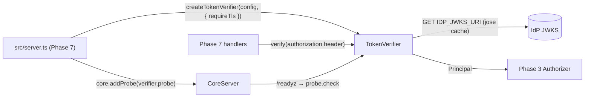

# P1.2 Verifier: JWT verification, remote key set, Phase 1 close

**Status: BINDING** (human said yes on 2026-10-03). Gates answered (D3, D4;
decision log Q26, Q27; timing config Q28 via P1.1 D4). Implement this file, not the brief cell in
[`phase-1.md`](phase-1.md).
**Public API:** v1.0 of `src/identity/index.ts`, the final Phase 1 surface. It
adds to [v0.1](PHASE1_P1.1_PRINCIPAL.md).
**Depends on:** Phase 0, P1.1.

## Context and scope

P1.1 gave Phase 1 its values (`Principal`, `AuthError`), the config schema,
`resolveSettings`, and `principalFromClaims`. P1.2 adds the only part that
touches keys and the network: `createTokenVerifier`, which turns an
`Authorization` header value into a `Principal`, an `AuthError`, or
`unavailable` when the IdP's keys cannot be fetched.

Facts:

- **Library.** `jose` is Phase 1's only third-party library
  ([`docs/typescript-standards.md`](../../docs/typescript-standards.md) §4,
  `policy/phase-composition.md` §4). It is not installed yet. `npm view`
  on 2026-10-03: latest is 6.2.12. `.npmrc` sets `save-exact=true`.
- **Measured behavior of `jose` 6.2.12** (scratch script on 2026-10-03, local
  `node:http` JWKS, RS256 keys, `jwtVerify` with `issuer`, `audience`,
  `algorithms: ['RS256']`, `requiredClaims: ['exp', 'sub']`):

  | Token or condition | Thrown |
  |---|---|
  | `exp` missing | `JWTClaimValidationFailed`, `claim: 'exp'`, `reason: 'missing'` |
  | `sub` missing | `JWTClaimValidationFailed`, `claim: 'sub'`, `reason: 'missing'` |
  | `exp` past | `JWTExpired` |
  | `nbf` future | `JWTClaimValidationFailed`, `claim: 'nbf'` |
  | wrong `iss` / `aud` | `JWTClaimValidationFailed`, `claim: 'iss'` / `'aud'` |
  | unknown `kid` | `JWKSNoMatchingKey` |
  | signed by another key | `JWSSignatureVerificationFailed` |
  | `alg: HS256`, `alg: none` | `JOSEAlgNotAllowed` |
  | `abc.def.ghi` | `JWSInvalid` |
  | `sub: 5` | **accepted** (P1.1 D6 narrows it) |
  | JWKS host refuses the connection | `TypeError` (from `fetch`, not a `JOSEError`) |
  | JWKS host never answers | `JWKSTimeout` after `timeoutDuration` |
  | JWKS host answers 500 | `JOSEError` (`ERR_JOSE_GENERIC`) |

- **Remote key set.** `createRemoteJWKSet` fetches lazily, deduplicates
  concurrent fetches, and defaults to a 5 s timeout, a 30 s cooldown before a
  missing `kid` triggers a refetch, and a 10 min cache. The returned function
  exposes `fresh` (cache younger than the max age) and `reload()`.
- **Claim errors carry the payload.** `JWTClaimValidationFailed.payload` is
  the full claim set (P1.1 D3).
- **Lakekeeper** refuses to boot when no provider loads its keys
  (`inspo/lakekeeper/crates/lakekeeper/src/service/authn.rs:383-390`). Its
  tests serve a JWKS from a local HTTP server (`authn.rs:1293-1330`).
- **Readiness.** `ReadinessProbe` is `{ name, timeoutMs, check(signal) }`.
  Core races every probe against its own timer and never waits past it
  ([P0.2 D5](PHASE0_P0.2_SERVER.md)). `src/server.ts` registers probes
  (`policy/phase-composition.md` §2).
- **Status mapping.** The product maps a dependency that is down to
  `UNAVAILABLE` ([`docs/product.md`](../../docs/product.md) "API"). The IdP
  key endpoint is such a dependency (decision log Q26).
- The brief's review ids (R5.1–R5.4, R8.6, R14; RR2, RR3, RR4, RR11) are
  carried as text. Their mapping files are not in this checkout.

P1.2 owns these exports: `TokenVerifier`, `createTokenVerifier`.

## Goals and non-goals

**Goals**

- G1 — Expired, wrong `aud`, wrong `iss`, `alg: none`, `HS256`, bad
  signature, unknown `kid`, missing header, and a `sub` with `#` each return
  `unauthenticated` with the matching reason and the same message. (brief
  done-when 1)
- G2 — Claim and suffix classification hold end to end through `verify`.
  (brief done-when 2, 3)
- G3 — Both service modes or neither, and an HTTP JWKS URI while TLS is
  required, fail `createTokenVerifier` with `invalid_argument`. (brief
  done-when 4, per P1.1 D5)
- G4 — An unreachable, slow, or failing JWKS endpoint is `unavailable`, never
  `ok` and never `unauthenticated`. (D3)
- G5 — Readiness is 503 while the key set cannot be loaded, and 200 once it
  can. (D4)
- G6 — No token, header, claim value, or key material appears in any error
  message or `cause`. (product "Secrets")
- G7 — No vendor string in `src/identity/`. Phase 1 closes. (brief done-when 5)

**Non-goals**

- Fetching keys at boot, or failing boot when the IdP is down. Readiness
  carries that signal (D4).
- OIDC discovery (`/.well-known/openid-configuration`). The brief configures
  `IDP_JWKS_URI` directly, which removes one fetch and one trust step.
- Checking the `typ` header, `iat` age (`maxTokenAge`), or `azp`. The product
  names none of them.
- Opaque tokens, token introspection, mTLS-bound tokens, DPoP.
- Tuning `jose`'s cooldown and cache age. They stay at the library defaults,
  stated in D1 (decision log Q28).
- Logging. A rejected token is a value. Phase 7's one line per RPC records
  the outcome.
- Wiring into `src/server.ts` and mapping to gRPC codes. That is Phase 7.

## The actual design

### Overview

`createTokenVerifier(config, deps)` runs `resolveSettings` (P1.1 D5), builds
one `jose` remote key set, and returns a `TokenVerifier` with:

- `verify(authorization)`: header → token → `jwtVerify` → `principalFromClaims`.
  Every expected failure is a value.
- `probe`: the readiness probe `src/server.ts` registers on the core server.

It is synchronous and does no I/O. The first fetch happens on the first
`verify` or the first `/readyz`, whichever comes first.

### System context



### APIs

These signatures are normative. Each export carries TSDoc with its contract,
error codes, and side effects.

```ts
export interface TokenVerifier {
  verify(
    authorization: string | undefined,
  ): Promise<Result<Principal, AuthError | AppError<'unavailable'>>>;   // D3; never rejects for token input
  readonly probe: ReadinessProbe;                                       // D4
}

export function createTokenVerifier(
  config: IdentityConfig,
  deps: { readonly requireTls: boolean },                               // P1.1 D5
): Result<TokenVerifier, AppError<'invalid_argument'>>;
```

The `verify` return type differs from the brief (`Principal` or `AuthError`).
It adds `AppError<'unavailable'>` because the user picked it (Q26, D3).

- **`verify` side effects.** It may fetch `IDP_JWKS_URI`, bounded by
  `IDP_JWKS_TIMEOUT_MS`. It never logs.
- **Programmer errors throw.** A thrown value that D3 does not classify is
  rethrown (standards §5). Phase 7 turns it into `INTERNAL`.

#### D1 — One remote key set, `jwtVerify` options from config, `jose` defaults stated

`createRemoteJWKSet(settings.jwksUri, { timeoutDuration: IDP_JWKS_TIMEOUT_MS })`,
built once per verifier. Cooldown (30 s) and cache age (10 min) are `jose`'s
defaults and are not set. They are recorded here so a `jose` upgrade that
changes them is a reviewed change (V12).

`jwtVerify(token, keys, options)`:

| Option | Value |
|---|---|
| `issuer` | `IDP_ISSUER`, exact compare |
| `audience` | `IDP_AUDIENCE` |
| `algorithms` | the `IDP_ALGORITHMS` list (asymmetric only, P1.1 D4) |
| `requiredClaims` | `['exp', 'sub']` (Q30) |
| `clockTolerance` | `IDP_CLOCK_TOLERANCE_S` |

No other option is set. The verified payload goes to `principalFromClaims`
with the verifier's `namespace` and `serviceMode`.

The ticket pins `jose` exactly (D6 in P0.1, `save-exact`), re-runs `npm view`,
and confirms that every algorithm in P1.1 D4's list verifies with a public JWK
on the pinned version. If one does not, it stops and reports.

#### D2 — Header parsing is strict

| `authorization` | Result |
|---|---|
| `undefined` or `''` | `missing` |
| `Bearer <token>`: scheme matched case-insensitively, exactly one space, `<token>` non-empty with no whitespace | the token goes to `jwtVerify` |
| anything else (`Basic …`, `Bearer`, `Bearer  x`, `Bearer a b`) | `malformed` |

The scheme is case-insensitive because RFC 7235 says so. One space and no
inner whitespace keep the parser to a single split with no trimming rules to
argue about.

#### D3 — Error mapping; key-set failures are `unavailable`

Picked by the user on 2026-10-03 (decision log Q26). A caller whose token is
fine must not see `UNAUTHENTICATED` because the IdP is down: callers drop
sessions on that code. The product already maps a dependency that is down to
`UNAVAILABLE`.

**Key-set failures are tagged where they happen.** `fetch` failures surface as
a bare `TypeError` (Context), so the verify step cannot tell them from a bug.
The key resolver passed to `jwtVerify` is a private wrapper around the remote
key set. Inside it:

- `JWKSNoMatchingKey` and `JWKSMultipleMatchingKeys` are rethrown as they are.
  They describe the token.
- Any other thrown value (`JWKSTimeout`, `JWKSInvalid`, a generic `JOSEError`
  from an HTTP status, or a non-`JOSEError` from `fetch`) is rethrown as a
  private `KeysUnavailable` error with the original as `cause`.

**Mapping in `verify`:**

| Thrown by `jwtVerify` | Result |
|---|---|
| `KeysUnavailable` | `err(appError('unavailable', 'identity provider keys unavailable', original))` |
| `JWKSNoMatchingKey`, `JWKSMultipleMatchingKeys` | `unknown_key` |
| `JWSSignatureVerificationFailed` | `bad_signature` |
| `JOSEAlgNotAllowed` | `algorithm_not_allowed` |
| `JWTExpired` | `expired` |
| `JWTClaimValidationFailed`, `claim` `iss` | `wrong_issuer` |
| `JWTClaimValidationFailed`, `claim` `aud` | `wrong_audience` |
| `JWTClaimValidationFailed`, `claim` `nbf` | `not_yet_valid` |
| any other `JOSEError` (`JWSInvalid`, `JWTInvalid`, a missing `exp` or `sub`, `JOSENotSupported`, …) | `malformed` |
| anything else | rethrown |

Then `principalFromClaims` adds `malformed` and `bad_subject` (P1.1 D6).

- An `AuthError` never has a `cause` (P1.1 D3). The `unavailable` error's
  `cause` is the fetch error. It holds the JWKS URL and the transport error,
  never the token.
- When a token has several defects, the reason is the first one `jose`
  checks. Tests use one defect per token.

#### D4 — Readiness probe, no boot fetch

Picked by the user on 2026-10-03 (decision log Q27). Lakekeeper fails boot
instead (Context). In a deploy with an orchestrator, a failed boot during an
IdP outage is a crash loop. Readiness gives the same "do not send traffic"
signal and recovers on its own.

`probe` is `{ name: 'identity-jwks', timeoutMs: IDP_JWKS_TIMEOUT_MS, check }`:

- If the key set is `fresh`, `check` resolves without I/O. Orchestrators poll
  every few seconds, and the IdP should not see one fetch per poll.
- Otherwise `check` awaits `reload()`. It resolves when keys load, and rejects
  with the fetch error when they do not. `jose` bounds the fetch with
  `timeoutDuration`. Core bounds the probe with `timeoutMs` (P0.2 D5), which
  is the same number.
- `check` ignores its signal: `reload()` takes none, and core does not wait
  for a probe past its timer.

Once the cache ages past 10 minutes, the next `/readyz` reloads. A long IdP
outage therefore turns readiness off within about the cache age plus one poll,
while `verify` keeps working on cached keys until then.

Probe causes go to core's `warn` line (P0.2 D6). They carry the JWKS URL and a
transport error, never a token.

#### D5 — Tests sign with `node:crypto`, against a local JWKS server

The brief asks for tests that sign their own tokens against a local JWKS.
`test/helpers/jwt.ts`:

- generates RSA and EC key pairs with `node:crypto` at test time. No key
  material is committed. This follows `test/helpers/tls.ts`.
- signs compact JWTs with `node:crypto` (`RS256`, `ES256`, plus `HS256` and
  `alg: none` tokens built by hand for the negative cases).
- serves a JWKS from a `node:http` server on port 0, with modes for serving,
  answering 500, never answering, and refusing connections (closed). It counts
  requests.

This is the local fake HTTP server the design names (standards §10).

Tests do not import `jose`. The signer is an independent implementation, so a
`jose` bug cannot cancel itself out in a test. Cost: about 80 lines of test
helper that `jose`'s `SignJWT` would replace.

The brief says the JWKS lives in `test/fixtures/`. It lives in `test/helpers/`
instead, because it is generated code with no committed file, and
`test/fixtures/` holds runnable fixtures (`shutdown-child.ts`).

#### D6 — No state outside the verifier, no logging

The key set, settings, and probe are created inside `createTokenVerifier`.
There is no module-level cache, so two verifiers in one test never share keys
(`policy/phase-composition.md` §1). Phase 1 does not log (brief).

## Alternatives considered

| Option | Why not |
|---|---|
| Key-set failure as `unauthenticated` with a `keys_unavailable` reason | Callers see a bad token and drop valid sessions during an IdP blip (Q26 option B) |
| Fetch keys at boot and fail on error (Lakekeeper) | Crash loop during an IdP outage (Q27 option B) |
| No probe, keys on the first request | The process reports ready when it cannot authenticate anyone (Q27 option C) |
| Classify errors in `verify` by error class only | A `fetch` `TypeError` looks like a bug, so an outage would surface as `INTERNAL` or be swallowed. The resolver wrapper tags it at the source (D3) |
| OIDC discovery from `IDP_ISSUER` | One more fetch and one more document to trust. The brief configures the key URL directly |
| `jose` in tests (`SignJWT`, `exportJWK`) | The library would check its own output (D5) |
| Committed key files under `test/fixtures/` | Private keys in the repo trip secret scanners and teach the wrong habit. Generated keys cost nothing (D5) |
| Probe that reloads on every `/readyz` | One IdP fetch per orchestrator poll per replica (D4) |
| Lenient header parsing (trim, any whitespace) | More cases for no product need. A client sending `Bearer  x` is broken and should hear so (D2) |
| `passport`, `fastify-jwt`, `@fastify/auth` | Request-scoped plugins that would put auth in Fastify hooks. Phase 7 owns the wire, and Phase 1 must stay a plain function (`policy/phase-composition.md` §3) |

## Cross-cutting concerns

- **Dependency direction.** `jose` is imported only by
  `src/identity/verifier.ts` (P1.1 D1). `src/identity/` imports
  `../core/index.ts` for `Result`, `AppError`, and `ReadinessProbe`. The fence
  rule `jose-owner` already exists (`.dependency-cruiser.cjs`).
- **Supply chain.** `jose` has no dependencies and no install script. Pinned
  exactly. CI installs with `--ignore-scripts` (P0.1 D6).
- **Secrets.** No token, header, claim, or key in any message or `cause`
  (D3, G6). The header is never stored. The core logger already redacts
  `authorization` (P0.2 D4).
- **Untrusted input.** The header is parsed once (D2). Claims are narrowed
  from `unknown` (P1.1 D6). The algorithm allowlist is config and asymmetric
  only, which closes `alg: none` and HMAC key confusion. Token size is bounded
  by the HTTP/2 header limit Node enforces before Phase 7 sees the request.
- **Outbound calls.** One host, `IDP_JWKS_URI`, HTTPS when TLS is required
  (P1.1 D5). Every fetch has `IDP_JWKS_TIMEOUT_MS` (standards §7). `jose`
  shares one in-flight fetch across concurrent callers.
- **Observability.** No log lines. Probe failures surface through core's
  `warn` line. The per-RPC outcome is Phase 7's.
- **Fail closed.** Any unclassified failure is either `malformed` or a
  rethrow, never `ok`. Key-set failure is `unavailable`. Readiness is off
  while keys cannot load.
- **Phase close.** Done when every brief done-when item and G1–G7 has a passing
  test, the CI gates pass, `index.ts` exports exactly the P1.1 and P1.2 APIs
  with TSDoc, and `test/contract/identity.test.ts` covers each export
  ([`README.md`](README.md) "Working on a phase").

## Review response

No review yet. The fresh Phase 1 review (`../reviews/phase-1.md`) adds rows
here: `# | Point | Response | Changed`.

Tickets: [`PHASE1_P1.2_VERIFIER_TICKETS.md`](./PHASE1_P1.2_VERIFIER_TICKETS.md)
